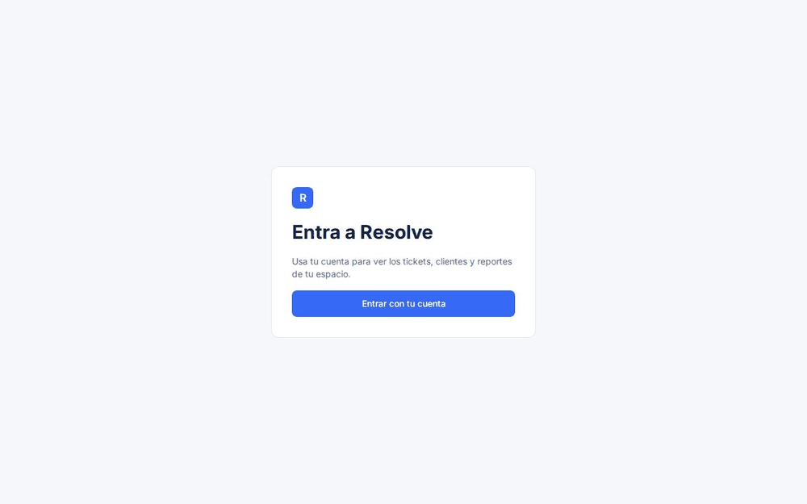
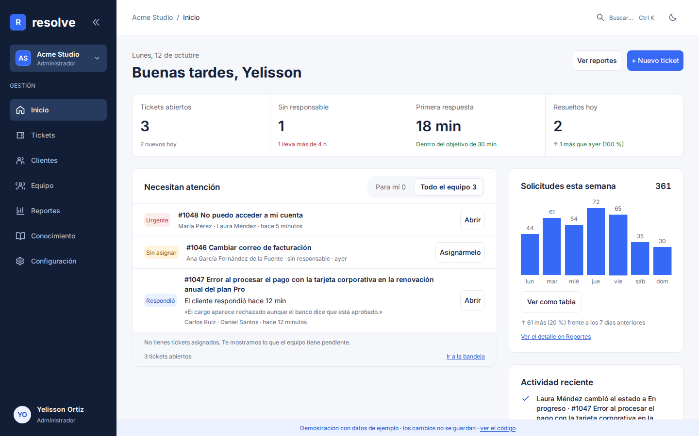
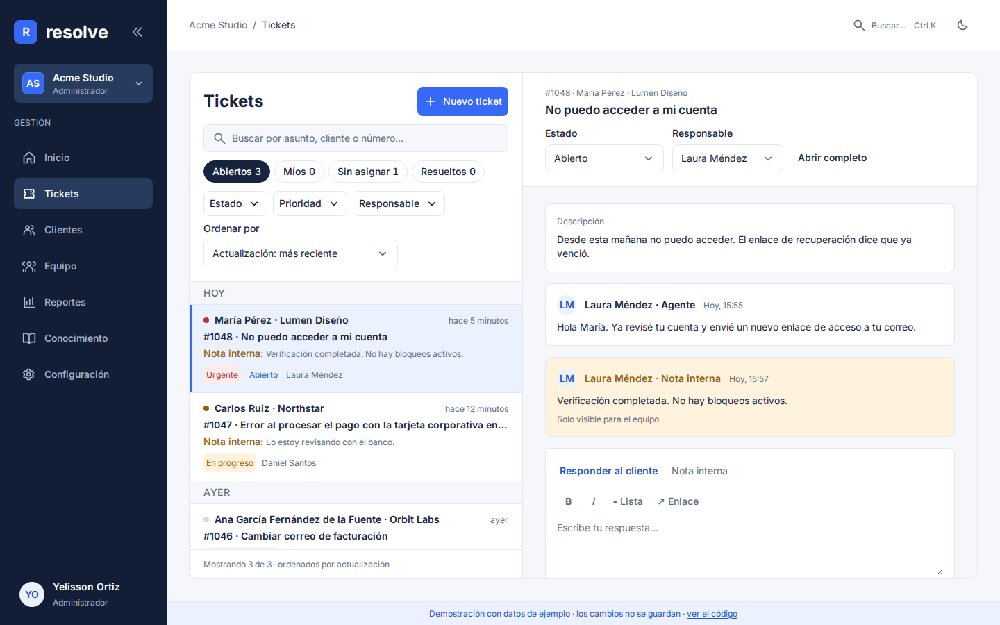
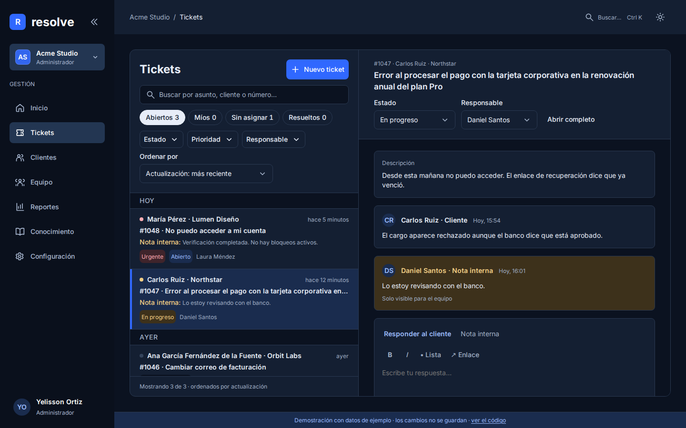
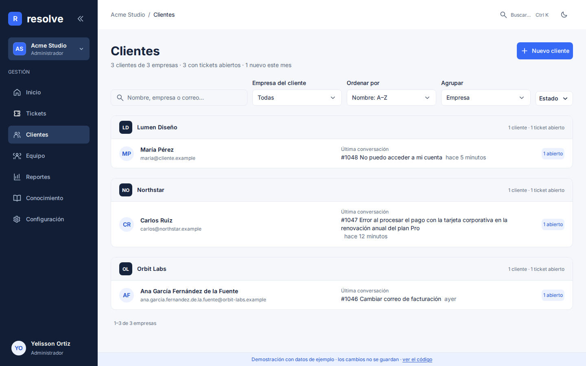
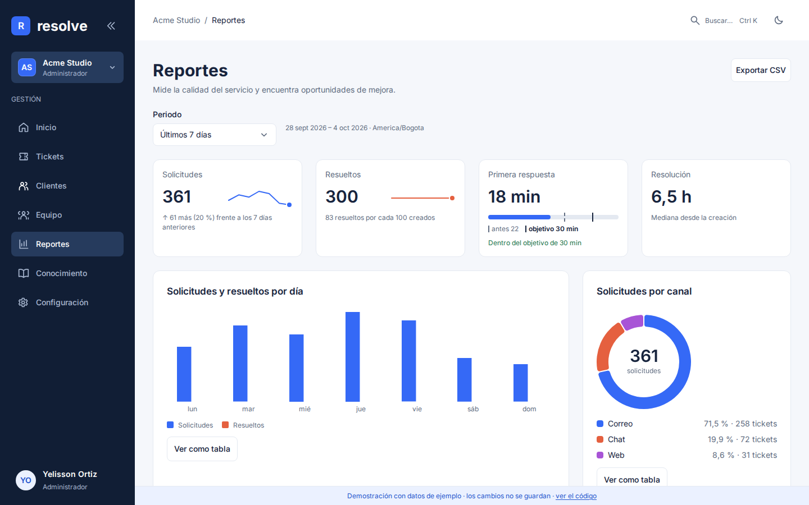
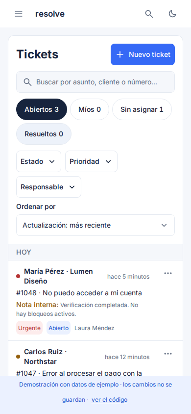
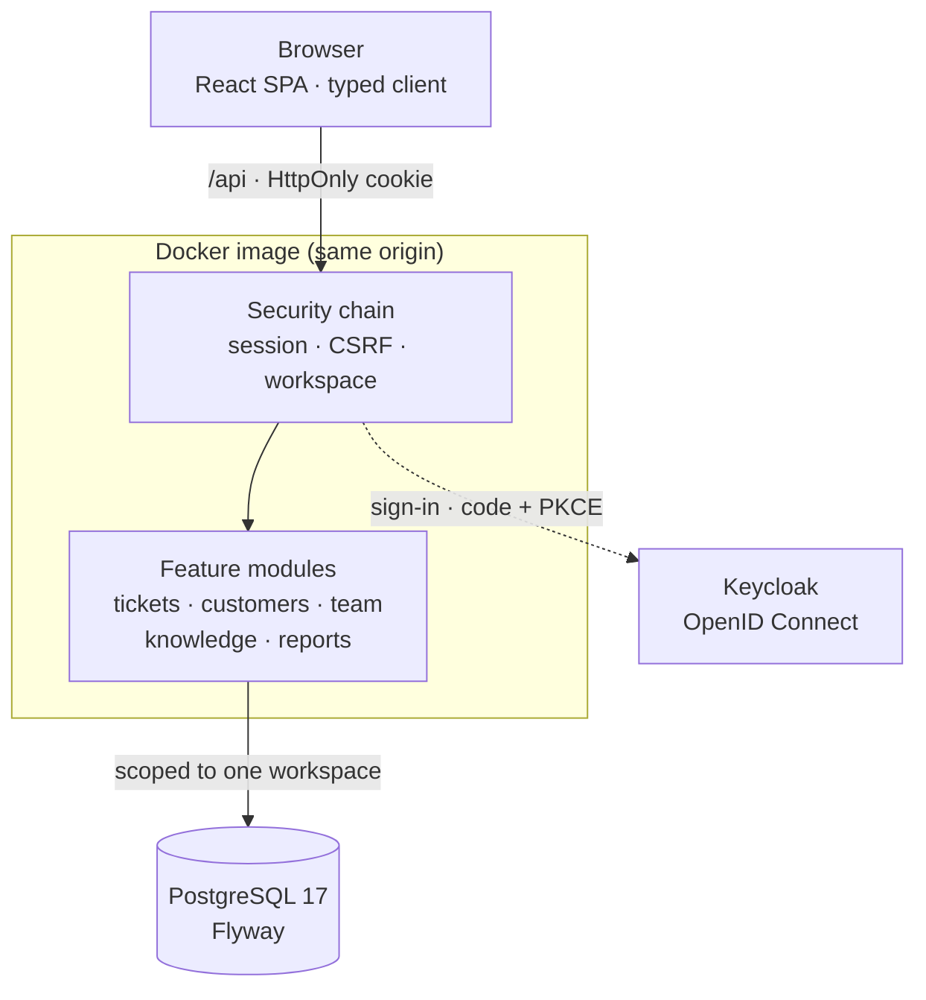
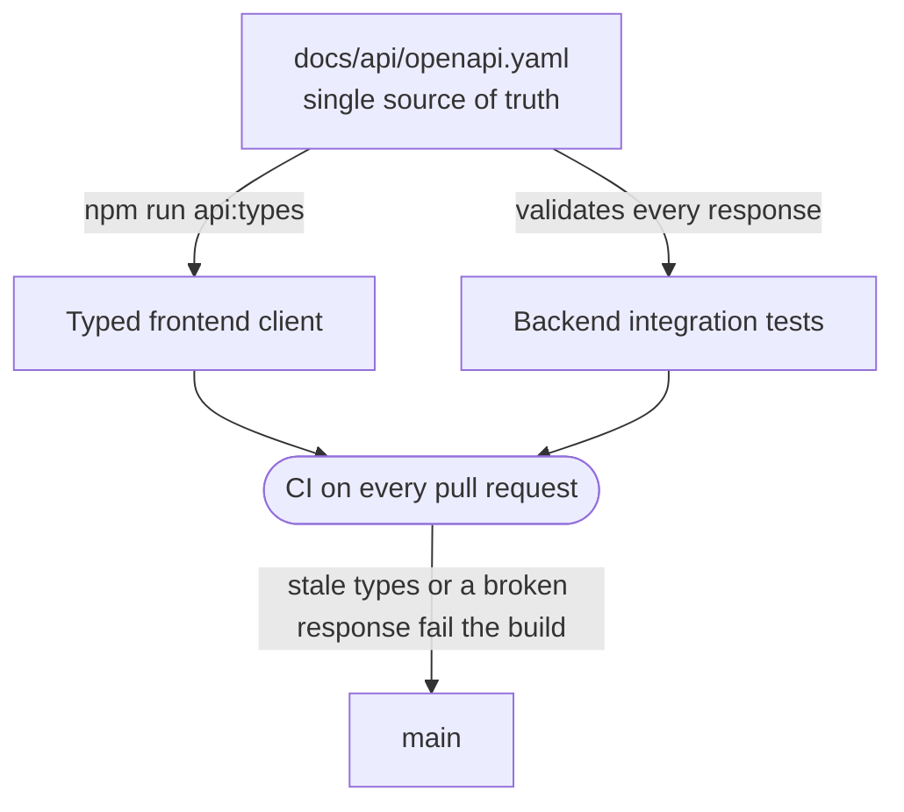

# Resolve

A customer-support platform: tickets, customers, team, reports, a knowledge base and several companies in one installation. I built it end to end from a complete Figma design: React and TypeScript on the front, Spring Boot and PostgreSQL behind it. The interface is in Spanish.

[](https://github.com/Yelison/resolve/actions/workflows/ci.yml) [](LICENSE)

**[Live demo](https://yelison.github.io/resolve/)** · **[Video tour](#see-it-working)** · **[Forma UI on npm](https://www.npmjs.com/package/@yelison/forma-ui)** · **[Documentation](#documentation)**

The live demo is the full frontend on GitHub Pages, running against a simulated API in your browser. Pick a demo user (administrator, agent or customer) and try it; every change is forgotten on reload.

## See it working



Recorded against the real stack (Spring Boot, Keycloak and PostgreSQL), with no simulated data. The script is [`scripts/readme-tour`](scripts/readme-tour/README.md).

## What it does

- **Tickets.** A shared inbox with views, filters and search, a preview next to the list, replies, internal notes, status and assignee. A new urgent ticket shows up on the home page.
- **Customers.** A directory grouped by company, with a profile, care context and each customer's tickets.
- **Team and workspaces.** Invitations, roles, and one person in several companies: switch between them or create a new one. Each workspace is isolated from the others.
- **Reports.** Requests, resolved, first response and resolution time by period, with every chart also available as a table.
- **Knowledge base.** Articles written in Markdown, with drafts, publishing, an outline and a link to open a ticket.
- **Three roles.** An **administrator** manages everything, an **agent** handles tickets without administering, and a **customer** sees only their own tickets and public answers and the published articles.

| Home | Tickets with preview |
| --- | --- |
|  |  |

| Ticket, dark theme | Customers |
| --- | --- |
|  |  |

| Reports | Tickets on a phone |
| --- | --- |
|  |  |

Screenshots are taken from the live demo by [`scripts/readme-screenshots`](scripts/readme-screenshots/capture.mjs). The data is fictional.

## Engineering highlights

- **Contract-first API.** [`docs/api/openapi.yaml`](docs/api/openapi.yaml) is the single source of truth. Backend tests validate every response against it, and extra fields fail. The frontend generates its types and client from it, and CI fails if they are stale. See [the API notes](docs/api/README.md).
- **Isolation by workspace, in the database.** The workspace always comes from the signed-in user. Composite foreign keys keep every reference inside one workspace, and ids from another one look exactly like missing ones. The decisions are in [ADR 0004](docs/decisions/0004-workspaces.md).
- **Safe concurrent edits.** Tickets carry an `ETag` and updates use `If-Match`, so a stale edit gets `412` and the UI reloads instead of overwriting someone else's change. Racing edits and replies are tested with real threads.
- **Accessibility.** WAI-ARIA patterns, native `<dialog>` with focus trap and focus return, tooltips that also open on focus (WCAG 1.4.13), announced field errors, 44 px touch targets, a skip link and `prefers-reduced-motion`. Everything is reachable by keyboard.
- **Responsive by content, not by device.** Two breakpoints (768 and 1200 px) and container queries; layout is checked at 320–1440 px and at the 767/768 and 1199/1200 edges, in both themes, with no horizontal overflow.
- **A published design system.** Sixteen components live in [`@yelison/forma-ui`](https://www.npmjs.com/package/@yelison/forma-ui) on npm; the rest are in [`frontend/src/components/ui`](frontend/src/components/ui). Tokens start in Figma and dark mode is a token swap. See [ADR 0001](docs/decisions/0001-forma-ui-extraction.md) and [ADR 0002](docs/decisions/0002-adopt-forma-ui.md).
- **Tests** (counts as of 2026-10-12). **1704** unit and component tests, **884** backend tests (mostly integration tests on PostgreSQL with Testcontainers), **1060** Playwright tests against a mocked API and **6** full-stack smoke scenarios against the real API.
- **How it was built.** Claude Code coordinated several agents, each in its own Git worktree, with an independent review before every merge and architecture decisions written as [ADRs](docs/decisions). The process is in [`docs/development/herdr.md`](docs/development/herdr.md).

## Architecture



- **One origin.** The image serves the web app and the API from the same address, so there is no CORS, no token in the browser and the session cookie stays `HttpOnly` and `SameSite=Lax`.
- **Sign-in.** The API is a confidential OpenID Connect client of Keycloak (authorization code with PKCE). Keycloak holds the passwords; every write carries a CSRF token.
- **One workspace per request.** The workspace comes from the session and is checked against the person's memberships on every request. Each query is scoped to it, composite foreign keys keep references inside it, and a write from a tab that still shows another workspace gets `409` and changes nothing.
- **Feature modules.** The backend has one package per feature (`tickets`, `customers`, `memberships`, `organizations`, `knowledge`, `reports`) on top of a small `common` package, and the frontend mirrors it in `src/features`.

### Contract first



The details are in the [development guide](docs/development/README.md#authentication) and the [API notes](docs/api/README.md).

## Tech stack

| Layer | Technology |
| --- | --- |
| Frontend | React 19, TypeScript (strict), Vite 8, TanStack Query, React Router 8, CSS Modules |
| UI | Forma UI ([`@yelison/forma-ui`](https://www.npmjs.com/package/@yelison/forma-ui)) and Resolve's own components, with design tokens |
| Backend | Java 25, Spring Boot 4, Spring Data JPA, Flyway |
| Data and identity | PostgreSQL 17, Keycloak (OpenID Connect) |
| Quality | Vitest and Testing Library, Playwright, oxlint, Prettier, GitHub Actions, Dependabot |

## Run it yourself

The complete stack (the production image with the web app inside, Keycloak with the development realm, and PostgreSQL with the demo data) starts with one command. It needs only [Docker](https://docs.docker.com/get-docker/) with Compose; the first build takes a few minutes.

```sh
cp deploy/env.prod.example deploy/.env.prod.local
echo 'SPRING_FLYWAY_LOCATIONS=classpath:db/migration,classpath:db/demo' >> deploy/.env.prod.local   # loads the demo data
docker compose -f deploy/docker-compose.prod.yml --env-file deploy/.env.prod.local -p resolve up -d --build
```

- **Open** `http://localhost:8080` and choose «Entrar con tu cuenta». Keycloak runs at `http://keycloak.localhost:8180` (browsers resolve `*.localhost` by themselves). Change `SERVER_PORT`, `POSTGRES_PORT` or `KEYCLOAK_PORT` in `deploy/.env.prod.local` if a port is taken.
- **Users** (password `demo`, a development value that is public on purpose): `yelisson.ortiz@acme.example` (administrator), `laura.mendez@acme.example` (agent), `maria.perez@cliente.example` (customer) and `jordi.puig@northwind.example` (agent of the second organization).
- **Stop it** and delete its data with `docker compose -f deploy/docker-compose.prod.yml --env-file deploy/.env.prod.local -p resolve down -v`.

The values in the variables file are fictional and only meant for this local test; Keycloak runs in development mode, so this is not a deployment. To work on the code (frontend dev server, API, tests), see the [development guide](docs/development/README.md#getting-started).

## Documentation

- [Development guide](docs/development/README.md): getting started, signing in locally, scripts, smoke test, authentication, the static demo and the project structure.
- [API contract](docs/api/README.md) and [`openapi.yaml`](docs/api/openapi.yaml).
- [Architecture decision records](docs/decisions): [Forma UI extraction](docs/decisions/0001-forma-ui-extraction.md), [adopting it](docs/decisions/0002-adopt-forma-ui.md), [customers directory](docs/decisions/0003-customers-directory.md) and [workspaces](docs/decisions/0004-workspaces.md).
- [Design decisions](docs/design-decisions.md): where the code departs from Figma and why, and the permissions table.
- [Deployment guide](docs/deploy/README.md) and [operations runbooks](docs/deploy/runbooks.md). A full deployment (Fly.io, Neon, nightly reset) is prepared and documented but **not published**, by my decision; the live demo and [Run it yourself](#run-it-yourself) take its place.
- [Working with Herdr](docs/development/herdr.md): several agents, worktrees and port slots.

## Status and roadmap

Every area of the product is done, in the views and in the Spring Boot API: home, tickets, customers, team, reports, knowledge base, settings and workspaces. Sign-in goes through OpenID Connect. Anything that is not built is not drawn as if it worked. What remains:

- [ ] Article ratings («¿Te resultó útil?»)
- [ ] Tags, attachments and SLA for tickets
- [ ] Sign-in: a specific problem type for an unverified email at the identity provider (#83)
- [ ] Demo realm: stable signing keys, so a deployment of the identity provider does not break the sign-out of open sessions ([limits of the demo](docs/deploy/README.md#limits-of-the-demo))
- [ ] Not planned: for real users, an own domain, a data retention and deletion policy, support with an SLA and alerting, and [publishing the full deployment](docs/deploy/README.md#the-public-demo-prepared-not-published)

## License

The code written for this project is released under the [MIT License](LICENSE), © 2026 Yelisson Ortiz.

Third-party software keeps its own license and attribution:

- npm and Maven dependencies are distributed under their respective licenses, listed in each package.
- The Inter typeface is bundled through [Fontsource](https://fontsource.org/fonts/inter) under the [SIL Open Font License 1.1](https://github.com/rsms/inter/blob/master/LICENSE.txt), © The Inter Project Authors.
- The Maven Wrapper scripts (`backend/mvnw`, `backend/mvnw.cmd`) are licensed under the Apache License 2.0, as stated in their headers.

## Author

Yelisson Ortiz · [Portfolio](https://yelison.github.io/) · [LinkedIn](https://www.linkedin.com/in/yelisson-ortiz)
